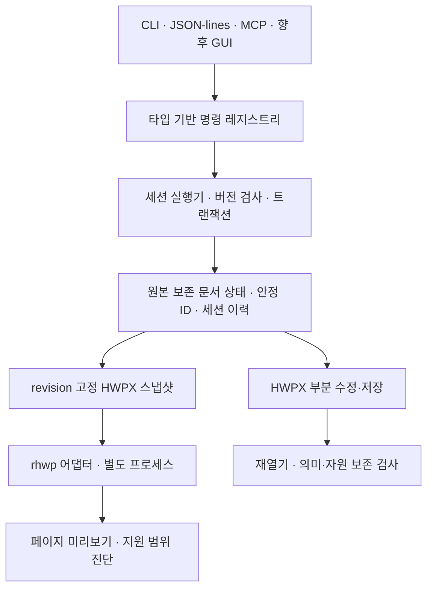

# 독립 HWPX 문서 엔진 0.1 설계서

작성일: 2026-10-16. 상태: **방향 선택 반영, 구현 전 검토본**. 규범 언어는 한국어다.

사용자 확정 방향: 자체 핵심 구조 + rhwp 선택 활용. 이 문서는 첫 하위 프로젝트인 명령 중심 HWPX 부분 편집 엔진을 다룬다. 전체 한컴오피스 기능, 네이티브 GUI, HWP 바이너리 편집 저장은 후속 프로젝트다.

## 1. 목적과 성공 기준

AI와 사람이 같은 문서 상태를 조회하고 같은 명령으로 편집할 수 있는 독립 엔진을 만든다. Linux에서 한컴 설치나 라이선스 없이 실행한다. 기존 HWPX에서 지정한 부분을 수정하고 수정하지 않은 내용·서식·자원을 보존하는 능력을 우선한다.

0.1의 대표 시나리오는 다음과 같다.

> 문서를 열어 표를 찾고, 특정 셀의 글을 바꾸고, 문단을 가운데 정렬하고, 기존 그림을 교체한다. 변경 내역과 미리보기를 확인하고, 전체 작업을 한 번에 되돌리거나 다시 적용한 뒤, 별도 HWPX로 저장하고 다시 열어 결과를 검사한다.

성공은 명령의 수보다 변경의 정확성, 보존, 실패 시 복원, 인터페이스 간 일관성으로 판단한다. 미리보기 생성이나 파일 저장 성공만으로 한컴 조판 호환성을 선언하지 않는다.

## 2. 첫 지원 범위와 제외 범위

지원 대상은 암호화하지 않은 ZIP/XML HWPX다. 여러 구역과 중첩 구조를 읽고, 본문·표 셀 문단·그림을 조회한다. 다음 편집만 먼저 제공한다.

- 일반 텍스트 범위 교체: 한 문단의 연속 텍스트 범위. 여러 run에 걸칠 수 있지만 수식·필드·개체 경계를 통과하지 않는다. 최초 run 서식을 새 텍스트에 적용하고, 범위 밖 run 서식은 유지한다.
- 문단 서식: 정렬과 백분율 줄간격. 스타일 정의를 직접 바꾸지 않고 필요한 문단 모양을 복제·재사용해 대상 문단에만 적용한다.
- 표 셀 텍스트: 병합되지 않은 단일 문단 셀에 한정한다. 병합 셀과 중첩 표는 조회·보존 대상이며 편집은 사유를 담아 거절한다.
- 기존 정적 PNG/JPEG 그림 교체: 위치·크기·캡션은 유지한다. 교체 자원을 새로 만들고 대상 그림의 참조만 바꾼다. 같은 자원을 참조하는 다른 그림은 유지한다.

수식은 HWP 스크립트와 개체 속성을 보존·조회하되 0.1에서 생성·편집하지 않는다. 표 행·열 변경, 문단 분할·병합, 문서 간 복사, 도형 편집, 변경 추적, 공동 편집, HWP5 읽기/쓰기, GUI는 이 판본의 완료 조건에서 제외한다. 그림 자르기·효과가 있는 대상은 교체하지 않는다. 교체 파일은 명령 검증 때 한 번 읽어 고정하고 hash·디코딩·픽셀 수를 검사한다. 정적 PNG/JPEG만 받으며 APNG·다중 프레임은 거절한다. commit과 Redo에서 경로를 다시 읽지 않고 검증한 원본 이미지 bytes를 사용한다. 악성·손상 입력과 실행 가능한 임베디드 개체는 처리하지 않는다.

## 3. 구조와 소유권



우리 실행기가 유일한 편집 권한을 가진다. MCP·CLI·GUI는 문서 모델이나 rhwp의 저수준 변경 함수를 직접 호출하지 않는다. 조회는 불변 revision 스냅샷을 사용한다. GUI가 아직 없어도 in-process 클라이언트 계약을 시험해 이후 GUI가 같은 실행기에 연결되도록 한다.

핵심 구현은 Rust다. 레지스트리·실행기·원본 보존 모델·HWPX I/O·어댑터·전송 계층을 분리한다. 핵심 계층은 MCP·GUI·rhwp에 의존하지 않는다. 기존 Python Workbench는 포맷 보존 사례와 합성 시험 자료를 참고하는 별도 도구로 유지하며 새 Rust 엔진을 구현했다고 간주하지 않는다.

## 4. 원본 보존 모델

문서 상태는 원본 패키지, 현재 패키지, 요소 인덱스, 의미 조회용 뷰, 변경 집합을 가진다. 정규 상태는 원본 보존 표현의 현재 패키지와 nodeId 대응표다. 원본 패키지는 불변 근거이며, 인덱스·의미 뷰·변경 집합·캐시는 파생물이다. commit 전에 정규 상태에서 파생물을 갱신·검증하고 불일치하면 STATE_INVARIANT_ERROR로 거절한다. 의미 조회용 뷰는 별도 편집 원장이 아니다.

- 수정하지 않은 ZIP 항목은 압축 해제 payload 바이트를 유지한다. ZIP 재압축 결과 전체 바이트 동일성은 약속하지 않는다. 무편집 내보내기는 원본 파일 바이트를 그대로 사용할 수 있다.
- XML은 원문 토큰 범위와 namespace·속성·불명 요소를 보존하는 표현을 사용한다. 임의 문자열 치환을 하지 않는다. 단순 DOM 전체 재직렬화로 불명 정보가 사라지는 경로를 허용하지 않는다.
- 변경한 XML은 잘 구성된 XML인지, 참조와 스타일·자원 관계가 맞는지, 지정된 변경 밖의 의미가 유지되는지 별도 검사한다.
- 패키지 전체 관계 그래프를 기준으로 자원을 보존한다. 사용하지 않는 자원을 자동 정리하는 기능은 0.1에 넣지 않는다.
- PrvText·썸네일·배치 캐시처럼 편집 후 낡는 정보는 알려진 규칙으로 갱신·무효화한다. 갱신할 수 없는 값은 진단에 기록한다. 알 수 없는 서명·암호화·변경 추적 영향이 있으면 편집을 거절한다.

원본 바이트를 보관하는 것과 편집 후 문서가 같은 의미·조판을 유지하는 것은 별도 성질이다. 외부 엔진의 렌더링 결과가 그럴듯해도 원본 내용을 복원하는 저장 경로로 대체하지 않는다.

## 5. 안정 ID와 저장·재열기

문서마다 documentId, 요소마다 무작위 안정 nodeId를 부여한다. nodeId 부여 대상은 구역·문단·표·셀·그림·수식·불명 요소 컨테이너다. run·문단 모양·미디어 리소스 항목은 이 공간에 넣지 않는다. 스타일과 미디어에는 별도 resourceId를 두며 resourceChanges로 생성·참조 변경을 보고한다. HWPX의 기존 ID·순번·페이지 위치는 원본 위치 정보로만 다루고 전역 고유성을 가정하지 않는다. ID는 문서 내에서 재사용하지 않는다. 0.1은 본문 트리 노드의 추가·삭제를 제공하지 않으므로 지원 편집과 Undo/Redo에서 같은 요소 ID를 유지한다.

독립 프로젝트 파일 `project.hwpwork`는 ZIP 컨테이너이며, manifest·불변 원본 HWPX·현재 HWPX·요소 대응표를 포함한다. 대응표는 현재 패키지 hash와 함께 저장하고, 프로젝트 재열기에서 hash·형식·nodeId 유일성·참조 대상·요소 종류를 검증한다. 패키지나 대응표가 바뀌었으면 복구를 추측하지 않고 `PROJECT_INTEGRITY_ERROR`로 거절한다. 프로젝트 저장은 임시 파일 검증 후 같은 파일시스템에서 원자적 교체한다.

독립 HWPX 내보내기에는 자체 ID용 사용자 정의 XML을 넣지 않는다. 내보낸 HWPX만 다시 열면 새 documentId와 nodeId가 생긴다. ID를 이어 쓰려면 프로젝트 파일을 재열어야 한다. 외부 렌더러나 저장·조회 경로는 이 대응표를 수정하지 않는다. 외부 프로그램이 수정한 HWPX를 이전 프로젝트에 연결해 ID를 추정 복원하는 기능은 후속 범위다.

프로젝트는 현재 내용·ID·revision을 지속 저장한다. Undo/Redo와 요청 중복 제거 기록은 세션 수명에만 유지하며 재시작 복원을 약속하지 않는다. Undo/Redo에서 같은 실체의 ID를 복원하는 것은 다른 실체에 ID를 재사용하는 것과 구분한다. 새 세션에는 새 sessionId를 부여해 이전 요청과 구분한다.

## 6. 명령 계약

Rust 명령 타입을 단일 출처로 삼아 입력 JSON Schema·발견 목록·CLI 파싱·MCP 설명을 생성한다. 각 명령은 입력·출력 타입, 조회/변경 구분, 필요한 지원 능력, 이력 정책을 선언한다. 정의되지 않은 속성은 거절한다. 레지스트리는 임의 문자열 명령을 내부 함수명으로 변환해 호출하지 않는다.

첫 명령군은 다음과 같다. 이름은 우리 API 제안이며 한컴·rhwp의 실제 명령명이 아니다.

| 명령 | 역할 |
|---|---|
| command.list / command.describe | 스키마·지원 상태·미지원 사유 발견 |
| document.open / document.inspect / document.close | 문서와 세션 수명 관리 |
| element.query / element.get | 내용·종류·속성으로 대상 찾기 |
| text.replace / paragraph.format / cell.setText / image.replace | 지원하는 부분 편집 |
| command.batch | 문서 상태의 원자적 편집 묶음 |
| history.undo / history.redo / history.clear | 공통 세션 이력 |
| document.snapshot / snapshot.release / document.diff | 스냅샷과 의미 변경 비교 |
| document.preview | 특정 revision 렌더링 |
| project.save / document.export | 프로젝트 보존·HWPX 출력 |

다음은 입력 예시다.

```json
{
  "schemaVersion": 1,
  "requestId": "req-0007",
  "writerId": "writer-example",
  "requestSequence": 7,
  "sessionId": "session-example",
  "documentId": "doc-example",
  "expectedVersion": 12,
  "command": "paragraph.format",
  "params": {
    "target": "para-example",
    "alignment": "center",
    "lineSpacing": {"kind": "percent", "value": 160}
  }
}
```

내용 변경 명령에는 expectedVersion을 필수로 받는다. 내용 상태가 변하면 revision을 1 증가시키고, 내용 무변경은 `mutated:false`와 같은 revision을 반환하며 이력을 추가하지 않는다. Undo도 새 상태 변경이므로 revision을 증가시킨다. 저장·조회·프리뷰는 내용 revision을 바꾸지 않는다.

실행기는 각 전송 연결에 writerId를 발급한다. 변경 명령은 writer별 requestSequence를 1부터 순서대로 보낸다. 가장 최근 처리 번호와 정규화 요청 hash·응답을 저장한다. 동일 번호·동일 내용은 버전 검사보다 먼저 이전 응답을 replay로 반환하고 재실행하지 않는다. 동일 번호·다른 내용은 `REQUEST_ID_CONFLICT`, 더 오래된 번호는 `REPLAY_TOO_OLD`, 순서를 건너뛴 번호는 `REQUEST_OUT_OF_ORDER`다. expectedVersion 경쟁으로 거절된 명령과 noop도 처리 번호를 소비한다. 구조가 잘못되어 writer·번호를 식별할 수 없는 요청은 번호를 소비하지 않는다.

이 중복 방지는 세션 내 문서 변경 명령에 적용한다. 저장·내보내기는 별도 I/O 계약을 따른다. 재접속은 새 writerId를 받고 현재 상태를 조회한다. 처리 완료 여부를 확인할 수 없는 요청을 새 writerId로 자동 재전송하지 않는다. requestId는 추적용이며 중복 판정은 writerId·requestSequence·정규화 입력으로 한다.

성공 응답은 outcome(applied/noop), mutated, beforeVersion, afterVersion, changedIds, 실제 적용값, 진단을 포함한다. replay 응답은 최초 결과임을 표시한다. 진단은 코드·대상ID·단계·중대도를 갖는다. outcome과 mutated가 서로 모순되는 응답은 계약 오류다. 대상 없음, 검색 결과의 모호함, 미지원 변경, 버전 경쟁을 구분한다. 현재 세션과 다른 sessionId는 SESSION_MISMATCH로 거절한다. 신규 요청은 버전 검사를 noop 판정보다 먼저 하며, Undo/Redo도 expectedVersion이 필수다. 빈 이력은 HISTORY_EMPTY 오류다. noop은 Redo 가지를 지우지 않는다.

텍스트 범위는 지정 revision에서 한 문단의 연속 텍스트 구간에 대한 사용자가 한 글자로 인식하는 확장 자소 군집(extended grapheme cluster)의 반개구간으로 표현한다. 구현 계획에서 Unicode 분할 알고리즘 버전과 라이브러리 버전을 고정하고 실행 메타데이터에 기록한다. 원문을 NFC/NFD로 자동 정규화하지 않으며 기본 검색은 원문 코드포인트 일치다. UTF-8 바이트·UTF-16 단위 변환은 모델이 책임진다. 범위 이탈은 `INVALID_RANGE`, 인라인 제어 경계 통과는 `RANGE_CROSSES_CONTROL`이다.

0.1의 text.replace는 비어 있지 않은 기존 범위만 받으며 빈 문자열로의 교체는 허용한다. 순수 텍스트 hp:t만 통과하고 탭·줄바꿈·필드·수식·개체를 건너지 않는다. 새 문자열에도 탭·줄바꿈을 허용하지 않는다. 교체 구간에 텍스트 외 자식이나 해석하지 못한 속성이 있으면 UNSUPPORTED_CONTENT_IN_RANGE로 거절한다. 새 텍스트는 첫 실제 교체 문자를 포함한 run의 서식을 쓴다. 뒤의 run 서식과 다르면 FORMAT_COLLAPSED 진단에 해당 범위를 기록한다. 문단 모양 복제는 불명 속성과 자식을 보존하며, 이를 보증할 수 없으면 거절한다. cell.setText에도 같은 규칙을 적용한다. 범위 밖 run은 유지하고, 비게 된 hp:t와 run은 제거하거나 이웃 run과 자동 병합하지 않는다.

## 7. 검색과 페이지 참조

검색은 요소ID·문맥·종류·revision을 반환한다. 페이지 위치에는 layoutRevision과 렌더러를 함께 기록한다. 검색 결과가 여러 개면 자동으로 첫 결과를 선택하지 않는다.

‘3페이지의 그림’은 해당 revision의 배치 결과에서 그림ID로 해석한다. 변경 시 expectedVersion이 다르면 다시 검색한다. 페이지 번호를 영구 편집 대상으로 쓰지 않는다. 페이지 미계산·근사 배치이면 그 상태를 알린다. rhwp 요소와 우리 nodeId는 구조 경로로 대조하고 유일하게 대응되지 않으면 페이지 정보를 unavailable로 한다. 페이지 정보는 source=renderer-estimated로 기록해 한컴 기준 위치로 오인하지 않게 한다.

## 8. 트랜잭션과 Undo/Redo

문서마다 변경을 직렬화한다. CLI는 한 프로세스에서 스크립트 전체를 실행하는 모드로 세션 이력을 사용한다. 독립된 일회성 호출 사이의 Undo/Redo는 SESSION_REQUIRED로 거절한다. 인터페이스 동등성 시험은 각 새 세션에서 같은 초기 프로젝트와 전체 명령 시나리오를 실행해 의미 상태를 비교하며, 실행마다 달라지는 sessionId/writerId는 비교에서 제외한다. batch는 한 문서의 편집 명령만 받으며 open/close, 저장, 프리뷰, 이력 명령, 중첩 batch를 포함하지 않는다. expectedVersion과 요청 번호는 batch 전체에만 존재하고 단계별 지정은 거절한다. expectedVersion은 batch 시작 시 한 번 검사한다. 각 단계의 텍스트 좌표와 전제조건은 직전 단계가 반영된 임시 상태를 기준으로 한다. 0.1에서는 새 본문 노드를 만들지 않으므로 모든 대상ID는 batch 시작 시 존재해야 한다.

입력을 검사한 뒤 격리된 상태에 순서대로 적용하고, 최종 불변조건과 메모리 한도를 확인해 한 번 commit한다. 실패하면 본문·ID 대응표·미디어 리소스·참조·캐시·이력·revision은 바뀌지 않는다. 실패 응답에는 실패 단계와 원인을 넣는다. 임시 미디어 리소스는 해제한다.

batch 전후의 의미 상태가 같으면 전체 noop으로 처리한다. 실제 변경이 있으면 한 Undo 단위와 revision 증가 1회로 처리한다. 비교에는 문서 내용·참조와 미디어 리소스를 포함하며 진단·일시 캐시는 제외한다.

이력의 before/after 스냅샷은 문서 내용, 원본 보존 표현, nodeId 대응표, 미디어 리소스와 참조, 캐시 무효화 상태를 함께 담는다. revision·요청 중복 기록은 내용 스냅샷과 분리한다. Redo는 명령을 다시 실행하지 않고 저장된 after 상태를 복원한다. 따라서 원본 이미지 경로의 파일이 바뀌어도 Redo 결과는 같다. Undo는 교체 당시 추가된 리소스까지 포함한 이전 패키지를 복원한다. 이것은 현재 상태에서 임의의 미사용 리소스를 정리하는 기능과 다르다.

기본 이력 상한은 100단위다. 101번째 정상 변경을 commit할 때 가장 오래된 단위를 해제하고 응답에 historyEvicted를 표시한다. 이 정상 개수 제한과 별도로, 메모리 제한을 넘으면 임의로 이력을 더 지우지 않고 변경을 거절한다. 이용자는 history.clear와 snapshot.release로 명시 해제할 수 있다. 두 명령은 내용 revision을 바꾸지 않으며 내용 변경과 동일한 직렬 실행 경로를 사용한다. 이력·스냅샷 제어 명령도 writer별 요청 번호를 소비하며, 응답은 controlChanged와 현재 내용 revision을 반환한다. 본문 편집의 outcome/mutated 규칙과 제어 결과를 혼동하지 않는다. 해제 후에는 해당 Undo나 diff가 불가능함을 응답한다. 명시 스냅샷은 자동 퇴거하지 않으며 세션 종료 시 해제한다.

새 변경은 Redo 가지를 제거한다. Undo/Redo로 내용을 복원해도 revision은 단조 증가한다. GUI의 연속 입력·IME 병합은 후속 범위이며 공통 이력 계층 위에 연결한다.

## 9. rhwp 후보와 역할

후보 커밋은 `1a76570e833917d15817415a53c09ad61ab3203f`다. 2026-10-16에 공식 Git main 참조를 조회해 고정했다. 이 커밋의 빌드·코드 감사·호환성 시험은 아직 수행하지 않았다. 구현 계획의 첫 평가에서 해당 커밋과 의존성·라이선스를 기록한다.

첫 연결은 별도 프로세스 어댑터다. 우리 정규 상태로 만든 HWPX 스냅샷을 읽어 구조를 대조하고 SVG 페이지를 생성한다. 실제 CLI 인자와 출력 계약을 해당 커밋에서 확인해 고정한다. 확인하지 않은 Rust API를 안정된 라이브러리로 가정하지 않는다.

rhwp에는 정규 문서 변경이나 프로젝트 저장 권한을 주지 않는다. 셸 문자열 대신 인자 배열을 사용하고, 시간 상한 60초·출력 크기 제한·취소·프로세스 종료를 관리한다. 실패·알 수 없는 응답은 문서 상태를 바꾸지 않고 명시 오류로 반환한다.

첫 지원 운영체제는 Linux다. 구현 전 읽기 전용 환경 점검에서 user namespace 등 격리 수단을 확인한다. 실제 어댑터는 비특권 실행과 네트워크 차단, 허가된 입력·폰트의 읽기 전용 마운트, 임시 출력 영역만 허용하는 격리를 사용한다. 도구와 정책은 구현 계획에 고정한다. 이를 검증할 수 없으면 프리뷰를 비활성화하고 RENDERER_UNAVAILABLE와 sandbox_unverified 사유를 반환하며 격리 성공이라고 기록하지 않는다. cwd와 인자 검증만으로 격리됐다고 부르지 않는다.

내장 그림은 유지한다. 외부 참조는 자동 다운로드하지 않고 외부 의존으로 진단한다. 그런 문서의 그림을 뺀 결과를 완전한 프리뷰로 표시하지 않는다. rhwp 실패 시 다른 렌더러로 몰래 전환하지 않는다.

## 10. 프리뷰와 차분

0.1의 표시 출력은 SVG와 파생 PNG다. PDF API는 필수 범위에서 제외한다. 스크립트·외부 참조가 없는지 검사한 SVG만 표시하며, 에이전트에는 가능하면 PNG를 제공한다.

내용 카운터 revision과 contentRevision은 같은 값이다. layoutRevision은 해당 입력·환경으로 만든 배치 산출물의 식별자이며 별도의 내용 카운터가 아니다. 프리뷰는 documentId·contentRevision·layoutRevision·입력 SHA-256·렌더러 커밋·폰트 목록과 hash·페이지 조건·진단을 기록한다. 렌더링 도중 새 편집이 일어나도 결과는 요청 당시 revision에 연결한다. stale 결과로 최신 내용을 덮어 표시하지 않는다.

출력 상태는 rendered, partial, failed로 구분한다. rendered는 산출물 생성에 성공했다는 뜻이며 한컴과의 일치를 뜻하지 않는다. 입력 요소의 지원 여부를 판정할 수 없으면 coverage를 unknown으로 표시한다. 알려진 미지원 요소나 폰트 대체는 반드시 진단한다. 미지원 요소 검출기가 없는데 누락 없이 렌더링했다고 추정하지 않는다. 100페이지를 넘으면 앞의 100페이지만 만들고 partial 및 PREVIEW_PAGE_LIMIT를 반환한다.

document.diff는 본문·속성·스타일 참조·표 구조·미디어 내용을 비교한다. ZIP 메타데이터와 표시 캐시는 별도 항목이다. 기대 변경은 요청에서 독립적으로 만들고, 저장 후 다시 파싱한 상태와 비교한다. 동일 함수의 결과를 자기 자신과 비교하는 검사로 보존을 입증하지 않는다. 알 수 없는 요소·속성은 원문 범위와 payload hash로 보전 여부를 함께 검사한다.

## 11. XML·패키지·입출력 계약

편집 가능한 XML 인코딩은 UTF-8로 한정한다. BOM·XML 선언·원문 개행은 유지한다. 다른 인코딩은 명시 거절한다. 원문 토큰과 byte span을 보존하고, 검증된 요소 범위만 교체한다. 텍스트 조회 시 문자참조·CDATA는 해석하되 원문 표기를 보관한다. 새 텍스트는 XML 규칙으로 escape하고 CDATA 구분자를 그대로 끼워 넣지 않는다. 변경 범위 밖 byte span을 유지한다. 전역 스타일 추가·리소스 manifest 변경은 별도 명시 변경 집합에 포함한다.

변경 후 각 요소 위치를 새 토큰 범위에 다시 연결한다. 프로젝트 대응표는 패키지 경로·요소의 구조 위치·종류·고유 nodeId를 저장하고 commit마다 갱신한다. 원본 HWPX ID가 중복돼도 내부 nodeId는 다르다. 미디어 리소스의 패키지 식별자는 본문 nodeId와 별개다.

수정한 문단의 줄 배치 캐시는 제거하고, 영향을 받는 구역의 배치 결과는 낡은 것으로 표시한다. 다른 문단의 캐시도 재조판의 확정 근거로 쓰지 않는다. 알려진 PrvText는 갱신하고 썸네일은 참조와 함께 무효화한다. 캐시 변경은 본문 변경과 분리해 diff에 기록한다. 이 규칙이 한컴에서 정상 재조판되는지는 별도 비교 시험으로 확인한다.

무편집 원본 bytes 통과는 revision 숫자가 아니라 현재와 원본의 payload 집합 hash 일치로 판정한다. hash는 항목명을 정렬한 (항목명, 압축 해제 payload SHA-256) 목록을 정규 JSON으로 인코딩해 계산한다. 프로젝트 manifest에는 이 payloadSetSha256와 저장한 현재 HWPX bytes의 currentFileSha256를 구분해 기록한다.

재작성 시 원본 항목 순서와 압축 방식을 유지하며 mimetype은 첫 번째 STORED 항목으로 둔다. 새 리소스 항목은 끝에 추가하고 manifest의 참조를 갱신한다. HWPX의 mimetype 값·최초 위치·무압축 조건, content.hpf와 spine·관계, META-INF 참조를 검사한다. 중복·대소문자 충돌·경로 이탈·암호화 항목과 DTD·외부 실체를 거절한다. ZIP 이름은 UTF-8만 지원한다. ZIP64가 필요한 크기는 초기 한도 밖이다. 압축률 단독으로 정상 문서를 배제하지 않고 항목별/전체 스트리밍 해제량을 제한한다.

기본 제한은 입력·출력 HWPX 각각 32MiB, 프로젝트 96MiB, 한 작업의 누적 ZIP 해제량 128MiB, 항목 2,048개, XML 깊이 128, 그림 4,096만 화소, 프리뷰 100페이지, 문서 세션 총 메모리 512MiB다. 프로젝트 안의 원본·현재 HWPX와 대응표도 누적 한도에 포함한다. 공유 버퍼는 한 번만 계산하고 실제 메모리 상한도 실행 환경에서 검증한다. 초과하면 commit 전 `RESOURCE_LIMIT`로 거절한다. 악성 입력을 실행하지 않으며 손상 문서를 자동 복구한 것으로 취급하지 않는다.

입출력 루트를 모든 인터페이스에 동일하게 적용한다. 원본 HWPX·입력 미디어 파일은 덮어쓰지 않는다. HWPX 내보내기는 별도 새 파일을 만들고 기존 경로가 있으면 거절한다. 프로젝트는 열 때 경로별 고정 .lock 파일에 프로세스 간 배타 잠금을 획득하고 세션 종료까지 유지한다. 잠금 실패는 PROJECT_LOCKED다. 교체되는 프로젝트 파일의 inode 자체에만 잠그지 않는다. 프로젝트 저장만 기존의 같은 프로젝트 경로를 원자적으로 교체할 수 있으며 마지막 저장 hash와 다르면 `EXTERNAL_MODIFICATION`으로 거절한다. 경로 alias·심볼릭 링크·hardlink를 검사하고 링크를 따르지 않는 디렉터리 핸들 기반 I/O를 사용한다.

임시 출력을 재파싱하고 기대 내용·보전 조건을 확인한 뒤 공개한다. 실패하면 기존 정상 프로젝트를 유지한다. 저장 시 임시 파일 fsync → 원자적 교체 → 부모 디렉터리 fsync 순서를 사용한다. project.save는 캡처한 revision을 파일에 저장하고 savedVersion을 응답할 뿐, 현재 내용 revision·이력을 바꾸지 않는다. 파일 저장과 문서 상태 commit을 하나의 원자적 작업이라고 표현하지 않는다.

JSON-lines·MCP의 최대 요청은 1MiB, JSON 응답은 4MiB다. 큰 본문은 커서로 나눠 조회하며 이미지는 별도 산출물로 반환한다. 지원 스키마 버전을 명시하고 진단은 stderr, 프로토콜은 stdout에 쓴다. 본문과 경로를 담은 상세 로그는 사용자가 지정한 경우에만 저장한다.

## 12. 클린룸 자료 경계

공개 포맷·API 문서, 출처와 라이선스를 확인한 오픈소스, 자작 시험 문서의 관찰 결과를 사용한다. SDK의 비공개 구현 코드·디컴파일 결과·독점 자산을 자체 구현 자료에 넣지 않는다. 공개 rhwp 코드의 라이선스에 따른 재사용과 비공개 한컴 구현의 독립 재구현을 혼동하지 않는다. 공개 코드를 본 사실 자체를 오염으로 취급하지 않으며, 본문 핵심으로 가져온 코드는 재사용 이력에 남긴다. 기존 설치 폰트의 로컬 사용과 폰트 파일의 재배포도 구분한다.

Windows 관찰 담당은 입력·조건·출력·오류를 기록한다. 구현 담당에게는 검토된 동작 명세와 시험 예만 전달한다. 관찰 담당의 전체 대화·작업 폴더를 구현 담당에게 상속하지 않는다. 모델을 바꾼 사실만으로 자료를 분리했다고 주장하지 않는다. 인계 기록에는 명세ID·작성 역할·검토 역할·근거 유형·첨부 hash를 넣는다. 기존 Workbench·공개 OWPML 모델에서 가져온 시험이나 코드도 출처와 라이선스를 기록한다. 한컴에서 생성한 자작 관찰 파일은 관찰 시험 자료로 표시한다. AI의 학습 데이터 노출까지 통제했다고 주장하지 않는다.

rhwp 재사용 부분은 의존 코드로 표시하고 버전·라이선스·수정 사항을 기록한다. 전체 프로젝트의 개발 경위를 검증했다고 주장하지 않는다. 관찰하지 않은 한컴 동작은 추정으로 남긴다. 이 규칙은 자료 출처를 관리하는 기술적 절차이며 법적 적합성을 판정한 결과가 아니다.

## 13. 검증과 첫 완료 조건

개인 최종 보고서를 시험 소재로 사용하지 않는다. 공개 이용 조건이 명확한 문서와 자작 최소 문서에서 다중 구역·분할 run·한글 자모·결합문자·이모지·표·그림·수식·불명 요소를 시험한다.

| 시험 | 통과 조건 |
|---|---|
| 무편집 저장 | 원본 bytes 유지 경로와 다시 열기 확인 |
| 부분 편집 | 요청한 변경이 남고 범위 밖 의미·서식·미디어가 보전됨 |
| 불명 요소 | 보관되는지 검사하고 지원 밖 영향은 거절함 |
| ID 지속 | 프로젝트 다시 열기에서 유지, 단독 HWPX 재가져오기는 새 문서로 구분 |
| 경쟁·재송신 | 오래된 버전·동일/변조 재송신·번호 누락을 규칙대로 처리 |
| batch 실패 | 본문·ID·참조·미디어·이력·revision이 그대로임 |
| Undo/Redo | 전체 내용 복원과 revision 단조 증가, 외부 이미지 변경에도 같은 Redo |
| 인터페이스 | CLI·JSON-lines·실제 stdio MCP에서 같은 의미 상태와 차분 |
| 프리뷰 | 고정 revision의 지원된 자작 문서에서 SVG·PNG 생성, 제한·폰트·coverage 진단 |
| 장애 | 자원 초과·어댑터 정지·취소·영역 밖 접근에 대한 명시 실패 |

0.1 완료에는 지원된 최소 시험 문서의 실제 rhwp 프리뷰와 격리 검증이 필요하다. 어댑터가 실패하면 코어 편집·저장 시험만 통과했다고 기록하며 전체 0.1을 완료로 표시하지 않는다. 임의 실무 문서에서의 한컴과의 일치는 별도 충실도 평가다. Windows 기준 출력과 비교하지 않았다면 native comparison은 not_checked다.

후속 기준 비교에서는 같은 폰트를 사용해 페이지 분할·줄바꿈·표 경계·수식 기준선과 잘림을 측정한다. 문서 의미 보전·구조 보전·픽셀 차이·한컴 호환을 각각 기록하고 하나의 ‘완전 호환’ 점수로 뭉치지 않는다.

## 14. 후속 프로젝트

수식 AST와 조판, 표 구조 편집, HWP5 읽기·변환, 재배치 정밀도, GUI·한국어 IME는 각각 별도 설계 단위로 진행한다. GUI 프레임워크는 여기서 선택하지 않으며 같은 코어를 사용한다는 계약만 정한다.

## 15. 근거와 다음 설계 단계

- [PhotoCraft](https://github.com/storytold/photocraft): 공통 명령 엔진과 독립 구현 원칙의 참고.
- [PhotoCraft 제어 프로토콜](https://github.com/storytold/photocraft/blob/main/docs/control-protocol.md): 인터페이스 계약의 참고. 타입 스키마는 자체 설계다.
- [rhwp 후보 커밋](https://github.com/edwardkim/rhwp/tree/1a76570e833917d15817415a53c09ad61ab3203f): Git 참조만 확인했으며 실행 평가는 하지 않았다.
- [rhwp Undo/Redo 문서](https://github.com/edwardkim/rhwp/blob/main/mydocs/tech/edit_action_undo_redo_architecture.md): 코어와 UI의 책임 경계 근거. 구현 평가에서 고정 커밋과 대조한다.
- [한컴 공개 모델](https://github.com/hancom-io/hwpx-owpml-model): 요소 구조·저장의 참고이며 조판 엔진과 구분한다.

설계 검토 후 구현 계획에서 소스 위치·의존성 고정·어댑터 계약 실측·시험 파일·실행 순서를 구체화한다. 새 엔진 제품 코드·의존성 설치·스캐폴딩은 설계 확인 이후 진행한다.
