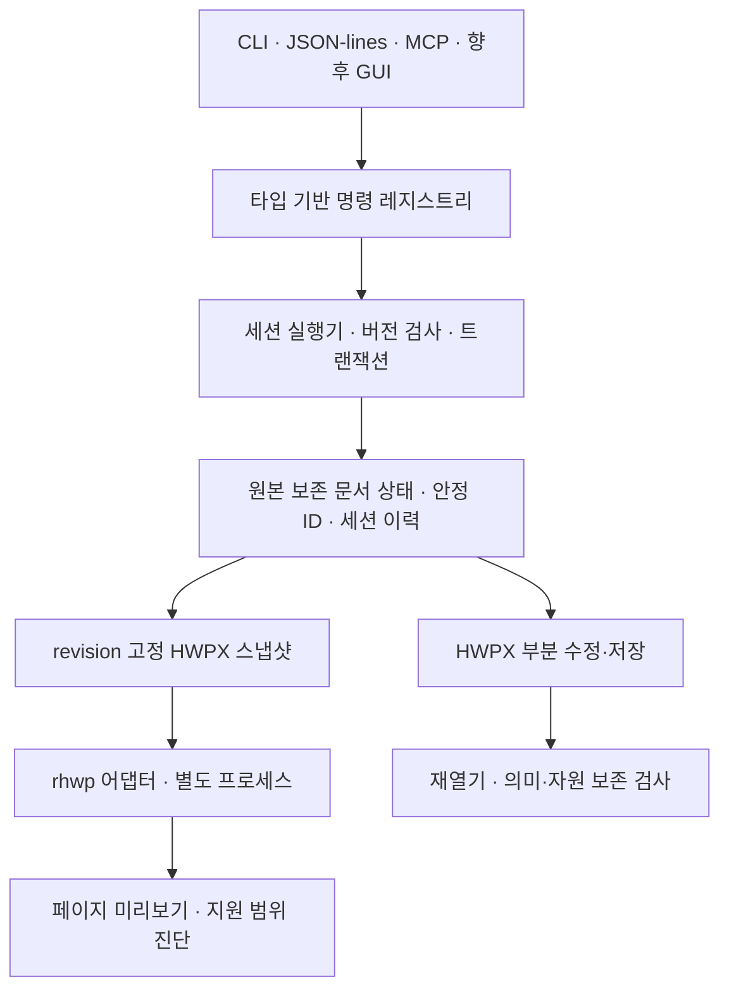

# 독립 한글 문서 엔진 0.1 설계서

작성일: 2026-10-16. 상태: **방향 선택 반영, 구현 전 검토본**.

사용자 확정 방향: 자체 핵심 구조 + rhwp 선택 활용. 이 문서는 첫 하위 프로젝트인 명령 중심 HWPX 부분 편집 엔진을 다룬다. 전체 한컴오피스 기능, 네이티브 GUI, HWP 바이너리 편집 저장은 후속 프로젝트다.

## 1. 목적과 성공 기준

AI와 사람이 같은 문서 상태를 조회하고 같은 명령으로 편집할 수 있는 독립 엔진을 만든다. Linux에서 한컴 설치나 라이선스 없이 실행한다. 기존 HWPX에서 지정한 부분을 수정하고 수정하지 않은 내용·서식·자원을 보존하는 능력을 우선한다.

0.1의 대표 시나리오는 다음과 같다.

> 문서를 열어 표를 찾고, 특정 셀의 글을 바꾸고, 문단을 가운데 정렬하고, 기존 그림을 교체한다. 변경 내역과 미리보기를 확인하고, 전체 작업을 한 번에 되돌리거나 다시 적용한 뒤, 별도 HWPX로 저장하고 다시 열어 결과를 검사한다.

성공은 명령의 수보다 변경의 정확성, 보존, 실패 시 복원, 인터페이스 간 일관성으로 판단한다. 미리보기 생성이나 파일 저장 성공만으로 한컴 조판 호환성을 선언하지 않는다.

## 2. 첫 지원 범위와 제외 범위

지원 대상은 암호화하지 않은 ZIP/XML HWPX다. 여러 구역과 중첩 구조를 읽고, 본문·표 셀 문단·그림을 조회한다. 다음 편집만 먼저 제공한다.

- 일반 텍스트 범위 교체: 한 문단의 연속 텍스트 범위. 여러 run에 걸칠 수 있지만 수식·필드·개체 경계를 통과하지 않는다. 최초 run 서식을 새 텍스트에 적용하고, 범위 밖 run 서식은 유지한다.
- 문단 서식: 정렬과 백분율 줄간격. 스타일 정의를 직접 바꾸지 않고 필요한 문단 모양을 복제·재사용해 대상 문단에만 적용한다.
- 표 셀 텍스트: 병합되지 않은 단일 문단 셀에 한정한다. 병합 셀과 중첩 표는 조회·보존 대상이며 편집은 사유를 담아 거절한다.
- 기존 정적 PNG/JPEG 그림 교체: 위치·크기·캡션은 유지한다. 교체 자원을 새로 만들고 대상 그림의 참조만 바꾼다. 같은 자원을 참조하는 다른 그림은 유지한다.

수식은 HWP 스크립트와 개체 속성을 보존·조회하되 0.1에서 생성·편집하지 않는다. 표 행·열 변경, 문단 분할·병합, 문서 간 복사, 도형 편집, 변경 추적, 공동 편집, HWP5 읽기/쓰기, GUI는 이 판본의 완료 조건에서 제외한다. 그림 자르기·효과가 있는 대상은 교체하지 않는다. 악성·손상 입력과 실행 가능한 임베디드 개체는 처리하지 않는다.

## 3. 구조와 소유권



우리 실행기가 유일한 편집 권한을 가진다. MCP·CLI·GUI는 문서 모델이나 rhwp의 저수준 변경 함수를 직접 호출하지 않는다. 조회는 불변 revision 스냅샷을 사용한다. GUI가 아직 없어도 in-process 클라이언트 계약을 시험해 이후 GUI가 같은 실행기에 연결되도록 한다.

핵심 구현은 Rust다. 레지스트리·실행기·원본 보존 모델·HWPX I/O·어댑터·전송 계층을 분리한다. 핵심 계층은 MCP·GUI·rhwp에 의존하지 않는다. 기존 Python Workbench는 포맷 보존 사례와 합성 시험 자료를 참고하는 별도 도구로 유지하며 새 Rust 엔진을 구현했다고 간주하지 않는다.

## 4. 원본 보존 모델

문서 상태는 원본 패키지, 현재 패키지, 요소 인덱스, 의미 조회용 뷰, 변경 집합을 가진다. 의미 조회용 뷰는 원본 보존 표현에서 파생되는 읽기 전용 결과이며 별도 편집 원장이 아니다.

- 수정하지 않은 ZIP 항목은 압축 해제 payload 바이트를 유지한다. ZIP 재압축 결과 전체 바이트 동일성은 약속하지 않는다. 무편집 내보내기는 원본 파일 바이트를 그대로 사용할 수 있다.
- XML은 원문 토큰 범위와 namespace·속성·불명 요소를 보존하는 표현을 사용한다. 임의 문자열 치환을 하지 않는다. 단순 DOM 전체 재직렬화로 불명 정보가 사라지는 경로를 허용하지 않는다.
- 변경한 XML은 잘 구성된 XML인지, 참조와 스타일·자원 관계가 맞는지, 지정된 변경 밖의 의미가 유지되는지 별도 검사한다.
- 패키지 전체 관계 그래프를 기준으로 자원을 보존한다. 사용하지 않는 자원을 자동 정리하는 기능은 0.1에 넣지 않는다.
- PrvText·썸네일·배치 캐시처럼 편집 후 낡는 정보는 알려진 규칙으로 갱신·무효화한다. 갱신할 수 없는 값은 진단에 기록한다. 알 수 없는 서명·암호화·변경 추적 영향이 있으면 편집을 거절한다.

원본 바이트를 보관하는 것과 편집 후 문서가 같은 의미·조판을 유지하는 것은 별도 성질이다. 외부 엔진의 렌더링 결과가 그럴듯해도 원본 내용을 복원하는 저장 경로로 대체하지 않는다.

## 5. 안정 ID와 저장·재열기

문서마다 documentId, 요소마다 무작위 안정 nodeId를 부여한다. HWPX의 기존 ID·순번·페이지 위치는 원본 위치 정보로만 다루고 전역 고유성을 가정하지 않는다. ID는 문서 내에서 재사용하지 않는다. 0.1은 구조 추가·삭제를 제공하지 않으므로 지원 편집과 Undo/Redo에서 같은 요소 ID를 유지한다.

독립 프로젝트 파일 `project.hwpwork`는 ZIP 컨테이너이며, manifest·불변 원본 HWPX·현재 HWPX·요소 대응표를 포함한다. 대응표는 현재 패키지 hash와 함께 저장하고, 프로젝트 재열기에서 hash·형식·nodeId 유일성·참조 대상·요소 종류를 검증한다. 패키지나 대응표가 바뀌었으면 복구를 추측하지 않고 `PROJECT_INTEGRITY_ERROR`로 거절한다. 프로젝트 저장은 임시 파일 검증 후 같은 파일시스템에서 원자 교체한다.

독립 HWPX 내보내기에는 자체 ID용 사용자 정의 XML을 넣지 않는다. 내보낸 HWPX만 다시 열면 새 documentId와 nodeId가 생긴다. ID를 이어 쓰려면 프로젝트 파일을 재열어야 한다. 외부 프로그램이 수정한 HWPX를 이전 프로젝트에 연결해 ID를 추정 복원하는 기능은 후속 범위다.

프로젝트는 현재 내용·ID·revision을 지속 저장한다. Undo/Redo와 요청 중복 제거 기록은 세션 수명에만 유지하며 재시작 복원을 약속하지 않는다. 새 세션에는 새 sessionId를 부여해 이전 요청과 구분한다.

## 6. 명령 계약

Rust 명령 타입을 단일 출처로 삼아 입력 JSON Schema·발견 목록·CLI 파싱·MCP 설명을 생성한다. 각 명령은 입력·출력 타입, 조회/변경 구분, 필요한 지원 능력, 이력 정책을 선언한다. 정의되지 않은 속성은 거절한다. 레지스트리는 임의 문자열 명령을 내부 함수명으로 변환해 호출하지 않는다.

첫 명령군은 다음과 같다. 이름은 우리 API 제안이며 한컴·rhwp의 실제 명령명이 아니다.

| 명령 | 역할 |
|---|---|
| command.list / command.describe | 스키마·지원 상태·미지원 사유 발견 |
| document.open / document.inspect / document.close | 문서와 세션 수명 관리 |
| element.query / element.get | 내용·종류·속성으로 대상 찾기 |
| text.replace / paragraph.format / cell.setText / image.replace | 지원하는 부분 편집 |
| command.batch | 문서 상태의 원자적 편집 묶음 |
| history.undo / history.redo | 공통 세션 이력 |
| document.snapshot / document.diff | 스냅샷과 의미 변경 비교 |
| document.preview | 특정 revision 렌더링 |
| project.save / document.export | 프로젝트 보존·HWPX 출력 |

다음은 입력 예시다.

```json
{
  "schemaVersion": 1,
  "requestId": "req-0007",
  "sessionId": "session-example",
  "documentId": "doc-example",
  "expectedVersion": 12,
  "command": "paragraph.format",
  "params": {
    "target": "para-example",
    "alignment": "center",
    "lineSpacing": {"kind": "percent", "value": 160}
  }
}
```

変更命令には expectedVersion を必須とする。成功した状態変更は revision を1増やす。内容が変わらない操作は `mutated:false`、revision不変、履歴追加なしとする。Undoも新しい変更なのでrevisionを増やす。保存・プレビューなどの非変更命令はrevisionを増やさない。

セッション内では同じ requestId と同じ正規化入力の再送を再実行しない。異なる入力による同一ID再利用は `REQUEST_ID_CONFLICT`。上限1,024件の記録を保持し、それ以上の変更は新セッションへの明示切替まで `SESSION_REQUEST_LIMIT` として拒否する。古いIDを黙って忘れて二重実行しない。

成功応答には applied/noop、beforeVersion、afterVersion、changedIds、実際に適用した値、診断を含める。診断はエラーコード・対象ID・段階・重大度を持つ。存在しない対象、曖昧な検索結果、未対応の変更、バージョン競合は別コードにする。

テキスト範囲は指定revisionにおける書記素クラスタ境界の半開区間で表現する。UTF-8バイト数やUTF-16コード単位と混同しない。変換はモデルの責任とし、結合文字・絵文字・改行・インライン制御の境界試験を含める。

## 7. 検索とページ参照

element.query は要素ID、文脈、種類、revisionを返す。ページ位置を返す場合はlayoutRevisionとレンダラー情報を付ける。曖昧な検索結果を自動的に一件目へ解決しない。

「3ページの図」は対象revisionのページ情報から図IDへ解決する。編集時にexpectedVersionが変わっていたら検索し直す。ページ番号そのものを永続編集対象にしない。ページ情報が未計算・近似なら、その状態を返し正確な位置として扱わない。

## 8. トランザクション・Undo/Redo

一文書一ライターで変更を直列化する。batchは単一文書の編集命令だけを受け付け、外部ファイル出力・プレビュー・open/close・入れ子batchを含めない。全入力の検証後、隔離状態へ順に適用し、各段階の前提と最終不変条件を確認して一度だけcommitする。途中失敗時は文書・ID対応・資源・キャッシュ状態・履歴を公開しない。

batchの成功は一つのUndo単位かつrevision増加1回とする。0.1ではトランザクション前後の共有可能なスナップショットを履歴に持つ。履歴は直近100単位とし、上限超過で最古を解放する。Redoは任意コマンドの再実行ではなく保存済みafter状態の復元とし、画像ファイルの変更など外部環境に結果を左右されない。変更命令が成功したらredo枝を消す。

履歴の内容スナップショットはrevisionと分離する。Undoで古い内容を戻してもrevisionは単調増加する。GUIの将来の連続入力・IME結合は同じ履歴境界を利用するが、0.1ではキーボード入力の結合機能は実装しない。

## 9. rhwpの役割と判本

候補コミットは `1a76570e833917d15817415a53c09ad61ab3203f`。2026-10-16に公式Git mainの参照を取得した。**このコミットをビルド・API監査・互換性試験した事実はまだない。** 後続の候補評価でこの判本を使用し、依存性とライセンスも記録する。

最初はプロセス境界のアダプターとする。正規状態から生成したスナップショットを読み取り、機械判読出力・構造照合・SVGページ生成を行う。呼び出すCLI引数と対応する出力契約は候補評価で実測し、アダプターの固定版契約として記録する。未確認のRust APIを既存の安定ライブラリとして設計の前提にしない。

rhwpには正規文書の編集権限・プロジェクト保存権限を与えない。引数配列で起動し、作業用ディレクトリと出力上限、単一ジョブ時間上限60秒、キャンセル、プロセス終了を管理する。タイムアウト・クラッシュ・未知の出力は明示エラーとし、文書状態は変えない。

画像・外部参照を制限したスナップショットを使い、無権限の作業用ユーザー/サンドボックスでネットワークと作業領域外アクセスを禁止する。0.1の対応実行先はLinuxに限定し、この隔離を検証できない環境ではアダプターを起動しない。引数制限や作業ディレクトリだけをサンドボックスと呼ばない。

rhwpが不適合だった場合はミリ単位の見た目を約束したり別のレンダラーへ黙って切り替えたりしない。編集・保存エンジンの試験と、失敗したレンダリング試験を分けて報告し、アダプター修正または代替の設計判断を再検討する。

## 10. プレビューと差分

最初の表示成果物はSVGページと、その派生PNGとする。HWPX出力と別に扱う。PDF出力の公開APIは0.1の必須条件にしない。SVGはスクリプト・外部参照を無効化して表示し、可能ならPNGをエージェントに渡す。

全プレビューにdocumentId・contentRevision・layoutRevision・入力SHA-256・rhwpコミット・フォント一覧とhash・ページ条件・診断を付ける。font fallbackと未対応描画は結果に表示し、同じページ数だけで一致としない。未対応の形状などを検出したらcomplete表示せずpartial/failedにする。

document.diff は本文・要素属性・スタイル参照・表構造・画像内容の差を返す。表示だけのキャッシュ・ZIPメタデータを意味差と混ぜない。画像差分は意味差分と別の結果にする。スナップショットの一方が履歴上限で失われていれば `SNAPSHOT_UNAVAILABLE` とし、比較を捏造しない。利用者が明示作成したスナップショットはセッション終了まで保持するがメモリ上限に従う。

## 11. I/O・資源と障害時の扱い

起動時の読み取り/書き込みルートを全転送経路に適用する。外部URLを自動取得しない。ZIPパスの逸脱・重複・暗号化、XMLのDTD/外部実体、参照先の欠損を検査する。HWPX入力32MiB、展開128MiB、ZIP項目2,048、XML深さ128、画像4,096万画素、プレビュー100ページ、文書セッション総量512MiBを既定上限とする。上限に達する命令はcommit前に `RESOURCE_LIMIT` とし、履歴や明示スナップショットを黙って破棄しない。

全出力は入力・原本・参照画像と重ならないパスに作る。シンボリックリンクとhardlinkのaliasを拒否し、ディレクトリハンドルを基点にリンクをたどらないI/Oと原子置換を使う。HWPXは一時出力を再解析し、期待変更と保全条件を確認してから公開する。失敗時は以前の正常出力を維持する。ファイル書き込みの成功と文書状態変更のcommitを同じトランザクションと称しない。

JSON-linesとMCPは同じ内部リクエスト型へ変換する。入出力サイズ上限と対応スキーマ版を公開し、診断ログは標準エラーへ、プロトコル応答は標準出力へ出す。パス・文書本文を含む詳細ログは利用者が明示した場合だけ保存する。

## 12. クリーンルームの資料境界

公開フォーマット/API文書、ライセンス確認済みオープンソース、自作文書による観察結果から実装する。漢字辞書・独占フォント・SDKの非公開実装コード・ディコンパイル結果を成果物に取り込まない。

観察担当はWindowsで入力・条件・期待出力・エラーを記録する。実装担当へ渡すのは審査済みの動作明細と試験例だけとする。観察担当の全会話や資料置き場を実装担当に継承しない。モデルを替えただけで資料分離したと主張しない。

rhwp等の再利用部分は依存コードとして版・ライセンス・改変有無を記録し、自作実装と分ける。MIT/Apache-2.0表示だけでそのプロジェクトの開発経緯全体を検証済みとはしない。Windowsの漢字処理・行分割など未観察の挙動は推定と記し、一般的な仕様として固定しない。

## 13. 検証と0.1の完了条件

試験は個人の最終報告書を使わず、公開利用条件が明確な文書と自作の最小文書から始める。試験素材は複数区画・分割run・日本語/漢字/韓国語混在・結合文字/絵文字・表・図・数式・不明要素を含める。

| 検証 | 合格条件 |
|---|---|
| 無編集保存 | 元ファイルbytesの維持経路と再開封を確認 |
| 部分編集 | 指定変更が保存後に残り、他の内容・書式・資源が保全される |
| 未対応要素 | 無編集通過と許可された局所変更で保持され、危険な影響範囲は明示拒否 |
| ID・再開封 | プロジェクト再開封でID維持、単独HWPXの再importは別文書と明示 |
| 状態・競合 | stale version・重複要求・batch途中失敗に対する不変条件を確認 |
| Undo/Redo | 本文・書式・図資源・IDが復元され、revisionは単調増加 |
| 複数インターフェイス | CLI・JSON-lines・実stdio MCPが同じシナリオで同じ意味状態を返す |
| プレビュー | 対象revisionと入力hashが一致し、フォント条件・未対応描画・上限が報告される |
| 障害・隔離 | parser異常、資源超過、renderの停止・タイムアウト、領域外アクセスを検証 |

文書構造・意味保全・描画・漢字処理互換の成績は別々に記録する。Windowsでの基準出力比較は、フォントを揃えた自作文書で行う。未実行ならnative comparisonはnot_checkedのままにする。0.1の技術的完了は上記実装試験で判定し、漢字処理エンジンの完全互換を意味しない。

## 14. 後続プロジェクト

0.1の保全と履歴を確立した後、数式AST/組版、表の構造編集、HWP5読み込みと変換、再レイアウトの精度向上、GUIと韓国語IMEをそれぞれ独立した設計・実装単位で進める。GUIのフレームワークはこの設計では選ばない。将来GUIも同じコアへ接続する契約だけを固定する。

## 15. 確認根拠と次の設計工程

- [PhotoCraft](https://github.com/storytold/photocraft): 統合レジストリと公開仕様・観察に基づく独立実装の参考。
- [PhotoCraft制御プロトコル](https://github.com/storytold/photocraft/blob/main/docs/control-protocol.md): command discoveryと各インターフェイスの契約。型スキーマは独自設計。
- [rhwp候補コミット](https://github.com/edwardkim/rhwp/tree/1a76570e833917d15817415a53c09ad61ab3203f): 参照取得済み、実行評価未実施。
- [rhwp Undo/Redo文書](https://github.com/edwardkim/rhwp/blob/main/mydocs/tech/edit_action_undo_redo_architecture.md): coreとUIの責任境界を調査。固定コミットでの再確認は候補評価に含む。
- [hwpx-owpml-model](https://github.com/hancom-io/hwpx-owpml-model): 公開モデルと要素保存の参考。組版エンジンとは区別。

この設計をレビュー後、実装計画で実験用コードの置き場、依存性固定、試験ごとのファイルと実行手順を具体化する。新規エンジンの製品コード・依存性導入・スキャフォールドは本設計確認後に行う。
