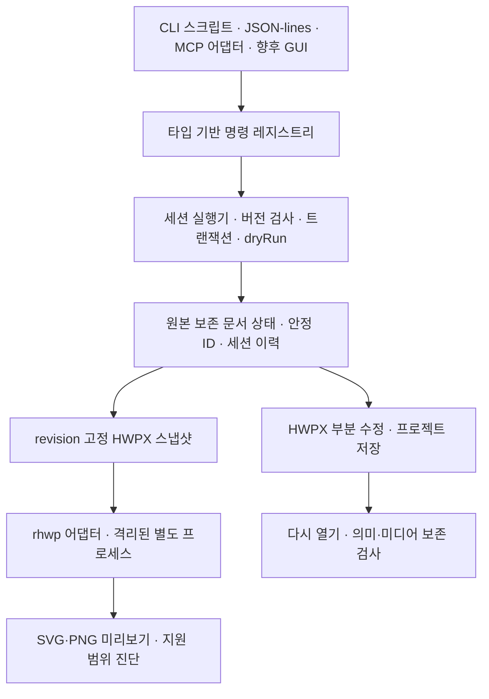

# 독립 HWPX 문서 엔진 0.1 설계서

작성일: 2026-10-16. 3차 개정: 2026-10-16(단계 0 결과와 구현 계획 검토 반영). 상태: **방향 선택 반영, 구현 전 검토본**. 규범 언어는 한국어다.

사용자 확정 방향: 자체 핵심 구조 + rhwp 선택 활용. 이 문서는 첫 하위 프로젝트인 명령 중심 HWPX 부분 편집 엔진을 다룬다. 전체 한컴오피스 기능, 네이티브 GUI, HWP 바이너리 편집 저장은 후속 프로젝트다.

## 1. 목적과 성공 기준

AI와 사람이 같은 문서 상태를 조회하고 같은 명령으로 편집할 수 있는 독립 엔진을 만든다. Linux에서 한컴 설치나 라이선스 없이 실행한다. 기존 HWPX에서 지정한 부분을 수정하면서 수정하지 않은 내용·서식·미디어를 보존하는 능력을 가장 먼저 확보한다.

0.1의 대표 시나리오는 다음과 같다.

> 문서를 열어 표를 찾고, 특정 셀의 글을 바꾸고, 문단을 가운데 정렬하고, 기존 그림을 교체한다. 적용 전 예상 결과와 적용 후 변경 내역·미리보기를 확인하고, 전체 작업을 한 번에 되돌리거나 다시 적용한 뒤, 별도 HWPX로 저장하고 다시 열어 결과를 검사한다.

성공은 명령의 수보다 변경의 정확성, 보존, 실패 시 복원, 인터페이스 간 일관성으로 판단한다. 미리보기 생성이나 파일 저장 성공만으로 한컴 조판 호환성을 선언하지 않는다.

가장 큰 기술 위험은 두 가지다. 원문 XML을 보존하면서 일부만 고칠 수 있는가, 그리고 편집한 문단의 줄 배치 캐시를 제거한 문서를 한컴과 rhwp가 정상적으로 다시 배치하는가이다. 이 두 가지를 본 구현 전에 확인한다(§14).

## 2. 첫 지원 범위와 제외 범위

지원 대상은 암호화하지 않은 ZIP/XML HWPX다. 암호화 문서는 열 때 거절한다. 전자서명·변경 추적이 있는 문서는 열 수 있지만 조회와 무편집 내보내기만 허용한다(§4). 여러 구역과 중첩 구조를 읽고, 본문·표 셀 문단·그림을 조회한다. 편집은 다음 네 가지만 먼저 제공한다.

- 텍스트 범위 교체: 한 문단 안의 연속된 일반 텍스트. 여러 run에 걸칠 수 있지만 탭·줄바꿈·필드·수식·개체를 통과하지 않는다.
- 문단 서식: 정렬과 백분율 줄간격. 스타일 정의를 바꾸지 않고, 같은 값의 기존 문단 모양을 재사용하거나 복제해 대상 문단에만 적용한다.
- 표 셀 텍스트: 병합되지 않고 문단이 하나인 셀의 전체 텍스트를 바꾼다. 빈 셀이라도 문단에 run이 하나 이상 있으면 쓸 수 있다. 병합 셀과 중첩 표는 조회·보존 대상이며 편집은 사유를 담아 거절한다.
- 그림 교체: 기존 그림의 위치·크기·캡션을 유지한 채 정적 PNG/JPEG로 바꾼다. 새 미디어 항목을 추가하고 대상 그림의 참조만 바꾸므로 같은 미디어를 쓰는 다른 그림은 그대로 남는다. 자르기·효과가 적용된 그림은 거절한다.

교체 이미지 파일은 명령 검증 때 한 번 읽어 고정하고 hash·디코딩·픽셀 수를 검사한다. APNG와 다중 프레임 이미지는 거절한다. commit과 Redo는 경로를 다시 읽지 않고 검증한 원본 바이트를 쓰며, 이미지를 다시 인코딩하지 않는다.

수식은 HWP 스크립트와 개체 속성을 보존·조회하되 0.1에서 생성·편집하지 않는다. 문단 추가·삭제·분할·병합, 표 행·열 변경, 문서 간 복사, 도형 편집, 변경 추적, 공동 편집, HWP5 읽기·쓰기, GUI는 이 버전의 완료 조건에서 제외한다. 실행 가능한 임베디드 개체는 다루지 않으며 손상된 문서를 자동 복구하지 않는다.

## 3. 구조와 소유권



우리 실행기만 문서를 변경한다. 모든 클라이언트는 같은 레지스트리와 실행기를 거치며, 문서 모델이나 rhwp를 직접 바꾸지 않는다. 조회는 불변 revision 스냅샷을 사용한다. GUI가 아직 없어도 in-process 클라이언트 계약을 시험해 이후 GUI가 같은 실행기에 연결되도록 한다.

핵심 구현은 Rust다. 레지스트리·실행기·원본 보존 모델·HWPX I/O·어댑터·전송 계층을 별도 crate로 나누고, 핵심 계층은 MCP·GUI·rhwp에 의존하지 않는다. 기존 Python Workbench는 형식 보존 사례와 합성 시험 자료를 참고하는 별도 도구로 남긴다.

## 4. 원본 보존 모델

정규 상태는 원본 보존 표현으로 된 현재 패키지와 nodeId 대응표다. 원본 패키지는 불변 근거로 보관하고, 요소 인덱스·의미 조회 뷰·변경 집합·캐시는 정규 상태에서 만든 파생물이다. commit 전에 파생물을 갱신·검증하고 불일치하면 STATE_INVARIANT_ERROR로 거절한다.

- 수정하지 않은 ZIP 항목은 압축 데이터를 다시 압축하지 않고 그대로 복사한다. ZIP 파일 전체의 바이트 동일성은 약속하지 않으며, 무편집 내보내기만 원본 파일 바이트를 그대로 쓴다.
- XML은 원문 토큰 범위와 namespace·속성·해석 불가 요소를 보존하는 표현으로 다룬다. 전체 DOM을 다시 직렬화하는 경로를 두지 않는다(§11).
- 변경한 XML은 올바른 XML인지, 참조와 스타일·미디어 관계가 맞는지, 지정한 변경 밖의 의미가 유지되는지 따로 검사한다.
- 패키지 관계 그래프 전체를 기준으로 미디어를 보존하며 쓰지 않는 미디어를 자동 정리하지 않는다.
- 암호화 항목이 있는 패키지는 열기 단계에서 거절한다(§11). 그 밖의 편집 허용 조건은 명시 목록으로 검사한다. 서명 항목과 변경 추적 요소가 없을 때만 문서 편집을 허용하고, 편집 대상을 ID로 참조하는 해석 불가 요소가 있으면 그 대상의 편집을 거절한다. 문서 조건을 만족하지 않으면 조회와 무편집 내보내기만 허용한다.

원본 바이트를 보관하는 것과 편집 후 문서가 같은 의미·조판을 유지하는 것은 별도 성질이다. 외부 엔진의 렌더링 결과가 그럴듯해도 원본 내용을 복원하는 저장 경로로 대체하지 않는다.

## 5. 안정 ID와 프로젝트

문서마다 documentId, 요소마다 무작위 nodeId를 부여한다. 대상은 구역·문단·표·셀·그림·수식·해석 불가 요소의 컨테이너다. run은 nodeId를 받지 않으며 (문단 nodeId, 텍스트 범위)로 가리킨다. 문단 모양·글자 모양·미디어 항목에는 별도 resourceId를 두고 resourceChanges로 생성과 참조 변경을 보고한다. HWPX 안의 기존 ID·순번·페이지 위치는 원본 위치 정보로만 다루며 전역 고유성을 가정하지 않는다.

nodeId는 한 문서 안에서 다른 요소에 다시 쓰지 않는다. 0.1은 본문 노드를 추가·삭제하지 않으므로 편집과 Undo/Redo를 거쳐도 요소 ID가 유지된다. Undo/Redo가 이전 상태의 같은 요소와 ID를 되살리는 것은 재사용으로 보지 않는다.

프로젝트 파일(.hwpwork)은 ZIP 컨테이너이며 manifest·불변 원본 HWPX·현재 HWPX·nodeId 대응표를 담는다. 대응표 키는 (패키지 항목 경로, 조상별 자식 순번으로 된 구조 경로, 요소 종류)이며 commit마다 갱신한다. manifest에는 현재 HWPX의 payloadSetSha256(§11), 대응표 hash, 내용 revision을 기록한다. 다시 열 때 hash·형식·nodeId 유일성·경로별 요소 종류를 검증하고, 하나라도 맞지 않으면 추측 복구 없이 PROJECT_INTEGRITY_ERROR로 거절한다.

세션은 다음 순서로 프로젝트와 연결된다.

1. document.open은 HWPX 또는 .hwpwork를 연다. HWPX를 열면 새 documentId와 nodeId를 만들고, 원본 파일 hash를 기록한 뒤 메모리 사본으로 작업한다. .hwpwork를 열면 무결성 검사 전에 그 프로젝트의 잠금을 얻고, 성공하면 세션을 즉시 프로젝트에 묶는다. 잠금을 얻지 못하면 PROJECT_LOCKED로 열기를 거절한다.
2. 프로젝트 없이 연 문서에 처음 project.save를 실행할 때는 새 경로가 필요하며, 이미 파일이 있으면 거절한다. 저장에 성공하면 세션이 그 프로젝트에 묶이고 잠금을 얻는다.
3. 이후 project.save는 같은 프로젝트 파일을 원자적으로 교체한다(§11).

프로젝트는 현재 내용·ID·revision을 저장한다. Undo/Redo와 요청 순서 기록은 세션 동안만 유지하며 재시작 후 복원을 약속하지 않는다. 다시 연 프로젝트의 revision은 저장된 값에서 계속 증가하고, 새 세션에는 새 sessionId를 부여한다.

일반 HWPX 내보내기에는 자체 ID를 넣지 않는다. 내보낸 HWPX만 다시 열면 새 문서로 취급하며, ID를 이어 쓰려면 프로젝트를 열어야 한다. 외부 프로그램이 수정한 HWPX를 이전 프로젝트에 연결해 ID를 추정 복원하는 기능은 후속 범위다. 렌더러와 조회·내보내기 경로는 대응표를 수정하지 않는다.

## 6. 명령 계약

### 레지스트리와 인터페이스 노출

Rust 명령 타입을 단일 출처로 삼아 입력·출력 JSON Schema, 명령 목록, CLI 인자, MCP 도구 정의를 생성한다. 각 명령은 조회/변경 구분, 필요한 지원 능력, 이력 정책을 선언하며 정의되지 않은 속성은 거절한다. 레지스트리는 임의 문자열을 내부 함수명으로 바꿔 호출하지 않는다.

MCP에서는 명령마다 별도 도구를 노출한다(예: text.replace → text_replace). 0.1은 명령 수가 적으므로, 범용 실행 도구 하나에 명령 이름과 인자를 끼워 넣는 방식보다 에이전트가 각 도구의 스키마를 직접 보는 편이 호출 정확도가 높다. 명령이 많아지면 같은 레지스트리로 PhotoCraft처럼 목록 조회와 범용 실행 도구 방식을 함께 제공할 수 있다.

첫 명령군은 다음과 같다. 이름은 우리 API 제안이며 한컴·rhwp의 실제 명령명이 아니다.

| 명령 | 역할 |
|---|---|
| command.list / command.describe | 스키마·지원 상태·미지원 사유 확인 |
| document.open / document.inspect / document.close | HWPX·프로젝트 열기, 구조 개요, 닫기 |
| element.query / element.get | 종류·텍스트·위치로 대상 찾기 |
| text.replace / paragraph.format / cell.setText / image.replace | 지원하는 부분 편집 |
| command.batch | 원자적 편집 묶음 |
| history.undo / history.redo / history.clear | 공통 세션 이력 |
| document.snapshot / snapshot.release / document.diff | 스냅샷과 의미 변경 비교 |
| document.preview | 특정 revision 렌더링 |
| project.save / document.export | 프로젝트 저장·HWPX 내보내기 |

편집 명령과 command.batch는 dryRun 선택 항목을 받는다.

### 요청 봉투

| 필드 | 의미 | 채우는 쪽 |
|---|---|---|
| schemaVersion | 요청 형식 버전 | 클라이언트 |
| documentId | 대상 문서 | 클라이언트 |
| expectedVersion | 내용 변경·Undo/Redo의 기준 revision | 클라이언트 |
| command, params | 명령과 인자 | 클라이언트 |
| dryRun | 적용하지 않고 결과만 계산 | 클라이언트(선택) |
| sessionId, writerId | 세션·작성자 | 실행기가 발급한다. JSON-lines 클라이언트는 받은 값을 돌려보내고, MCP·CLI 스크립트·GUI는 해당 어댑터가 채운다 |
| requestSequence | writer별 요청 순서 | JSON-lines는 클라이언트, 그 밖에는 해당 어댑터 |
| requestId | 로그 추적 | 선택 |

MCP를 쓰는 에이전트는 documentId·expectedVersion·명령 인자만 다룬다. 요청 순서 번호는 MCP 어댑터가 연결마다 붙인다. 언어 모델이 순서 번호를 직접 관리하면 번호 누락과 중복이 잦기 때문이다. 에이전트가 같은 편집을 실수로 두 번 호출해도 두 번째 호출은 첫 호출로 revision이 바뀐 뒤라 VERSION_CONFLICT가 되므로 중복 적용되지 않는다.

다음은 JSON-lines 원형 요청의 예다.

```json
{
  "schemaVersion": 1,
  "sessionId": "session-example",
  "writerId": "writer-example",
  "requestSequence": 7,
  "requestId": "req-0007",
  "documentId": "doc-example",
  "expectedVersion": 12,
  "command": "paragraph.format",
  "dryRun": false,
  "params": {
    "target": "para-example",
    "alignment": "center",
    "lineSpacing": {"kind": "percent", "value": 160}
  }
}
```

### revision과 응답

내용 변경 명령과 Undo/Redo는 expectedVersion을 필수로 받으며, 버전 검사를 무변경 판정보다 먼저 한다. 내용이 바뀌면 revision을 1 올리고 outcome=applied를 돌려준다. 내용이 그대로면 outcome=noop이며 revision·이력·Redo 가지가 그대로다. Undo/Redo도 새 상태 변경이므로 revision을 올린다. 이력이 비어 있으면 HISTORY_EMPTY다. 조회·저장·내보내기·프리뷰와 이력·스냅샷 해제는 내용 revision을 바꾸지 않는다.

응답에는 outcome, beforeVersion, afterVersion, changedIds, resourceChanges, 실제 적용값, 진단을 담는다. 진단은 코드·대상 ID·단계·심각도를 가진다. 대상 없음(TARGET_NOT_FOUND), 대상 모호(AMBIGUOUS_TARGET), 지원하지 않는 변경(UNSUPPORTED), 버전 충돌(VERSION_CONFLICT)을 구분한다. 현재 세션과 다른 sessionId는 SESSION_MISMATCH로 거절한다.

dryRun이 참이면 실제 요청과 같은 검증과 적용을 격리 상태에서 수행해 예상 outcome·변경 비교·진단을 돌려주고 결과를 버린다. revision·이력·요청 순서는 바뀌지 않으며, 응답에는 기준 revision을 붙인다. 실제 적용은 같은 expectedVersion으로 다시 요청한다. 그 사이 다른 변경이 있었다면 VERSION_CONFLICT가 되어 미리 본 결과와 다른 변경이 적용되지 않는다.

### 요청 순서와 중복 방지

실행기는 연결마다 writerId를 발급하며 writerId는 그 연결에서만 유효하다. 발급하지 않았거나 다른 연결에 속한 writerId는 UNKNOWN_WRITER로 거절한다. 내용 변경 요청과 이력·스냅샷 제어 요청은 writer별 requestSequence를 1부터 차례로 사용한다. 실행기는 writer마다 마지막 처리 번호, 정규화한 요청 hash, 응답을 기억한다.

- 같은 번호·같은 내용: 버전 검사 전에 저장된 응답을 replay 표시와 함께 돌려주고 다시 실행하지 않는다.
- 같은 번호·다른 내용: REQUEST_ID_CONFLICT.
- 더 오래된 번호는 REPLAY_TOO_OLD, 건너뛴 번호는 REQUEST_OUT_OF_ORDER.
- writer와 번호를 식별한 요청은 결과가 성공·noop·오류(버전 충돌과 자원 한도 포함) 중 무엇이든 번호를 소비한다. 다시 시도하려면 새 번호를 쓴다. 형식이 잘못되어 writer·번호를 알 수 없는 요청은 번호를 소비하지 않는다.

재접속하면 새 writerId를 받고 현재 상태를 조회한다. 처리 여부가 불확실한 요청을 새 writerId로 자동 재전송하지 않는다. 조회·dryRun·프리뷰는 순서 번호를 쓰지 않는다. project.save와 document.export도 순서 번호 대상이 아니다. 같은 저장을 반복하면 같은 내용을 다시 쓰고, 같은 내보내기를 반복하면 대상 경로가 이미 있어 거절되므로 중복 부작용이 생기지 않는다.

### 세션과 인터페이스

CLI는 한 프로세스에서 명령 스크립트 전체를 실행하는 모드로 세션 이력을 사용한다. 독립된 일회성 호출 사이의 Undo/Redo는 SESSION_REQUIRED로 거절한다. 인터페이스 동등성 시험은 각 인터페이스의 새 세션에서 같은 초기 프로젝트와 같은 명령 시나리오를 실행하고, 실행마다 달라지는 sessionId·writerId를 뺀 의미 상태와 변경 비교 결과를 대조한다.

### 텍스트 범위와 편집 규칙

텍스트 범위는 지정 revision의 한 문단 안에서 확장 자소 군집(사용자가 한 글자로 인식하는 단위)의 반개구간 [start, end)으로 표현한다. 구현 계획에서 Unicode 분할 규칙과 라이브러리 버전을 고정하고 실행 메타데이터에 기록한다. 원문을 NFC/NFD로 정규화하지 않으며 기본 검색은 코드포인트 일치다. 일치 구간의 양 끝이 자소 군집 경계와 맞지 않으면 그 일치는 결과에서 빼고 진단의 unalignedMatches 수에만 반영한다. UTF-8 바이트나 UTF-16 단위와의 변환은 모델 계층이 맡는다. 범위가 문단을 벗어나면 INVALID_RANGE, 탭·줄바꿈·필드·개체 경계를 지나면 RANGE_CROSSES_CONTROL이다.

text.replace는 길이가 1 이상인 기존 범위만 받으며, 빈 문자열로 바꾸는 삭제는 허용한다. 위치만 지정하는 삽입은 0.1에서 받지 않는다. 새 문자열에 탭·줄바꿈이 있으면 거절한다. 범위 안에 텍스트 외 자식이나 해석하지 못한 속성이 있으면 UNSUPPORTED_CONTENT_IN_RANGE다. 새 텍스트는 범위의 첫 글자를 담은 run의 글자 모양을 쓴다. 범위가 다른 글자 모양의 run에 걸쳐 있었다면 FORMAT_COLLAPSED 진단에 해당 구간을 남긴다. 범위 밖 run은 그대로 두고, 비게 된 텍스트 요소와 run은 지우거나 이웃 run과 합치지 않는다.

cell.setText는 대상 셀 문단의 전체 텍스트를 바꾼다. 텍스트가 있으면 전체 범위에 text.replace와 같은 규칙을 적용한다. 빈 셀이면 문단의 첫 run에 텍스트를 넣고 그 run의 글자 모양을 쓴다. run이 없거나 문단이 둘 이상이면 UNSUPPORTED로 거절한다.

paragraph.format은 대상 문단의 현재 문단 모양에서 요청 값만 바꾼 모양을 찾는다. 같은 값의 기존 모양이 있으면 재사용하고, 없으면 복제해 새 resourceId로 추가한다. 복제할 때 해석하지 못한 속성과 자식을 그대로 옮기며, 이를 보장할 수 없으면 거절한다. 스타일 정의와 다른 문단은 바꾸지 않는다.

## 7. 조회와 페이지 참조

document.inspect는 문서를 에이전트가 읽기 쉬운 개요로 돌려준다. 각 항목에 nodeId, 종류, 부모, 텍스트 앞부분, 표의 행·열 수, 그림의 크기와 미디어 hash, 편집 가능 여부와 거절 사유를 담는다. 큰 문서는 커서로 나누고, 모든 응답에 조회 기준 revision을 붙인다.

element.query는 종류, 텍스트 포함 여부(코드포인트 일치), 조상 nodeId로 대상을 좁힌다. 표 셀은 (표 nodeId, 행, 열)로 찾을 수 있으며, 행과 열은 HWPX 셀 주소를 0부터 센 값이다. 병합 셀은 시작 주소와 행·열 병합 수를 함께 보고한다. 결과가 여러 개면 첫 결과를 자동으로 고르지 않고 모두 돌려준다.

‘3페이지의 그림’은 해당 revision의 배치 결과에서 그림 ID로 해석한다. 편집할 때 expectedVersion이 다르면 다시 찾는다. 페이지 번호를 영구 편집 대상으로 쓰지 않는다. 페이지가 아직 계산되지 않았거나 근사 배치이면 그 상태를 알린다. rhwp 요소와 우리 nodeId는 구조 경로로 대조하고, 유일하게 대응되지 않으면 페이지 정보를 unavailable로 한다. 페이지 정보에는 source=renderer-estimated를 붙여 한컴 기준 위치로 오인하지 않게 한다. 단계 0 S2 결과에 따라 0.1은 최상위 문단·표·셀·그림(키가 유일한 것)의 쪽 정보만 제공한다. 구역 번호는 content.hpf spine 순서로 맞춘다. 그룹·글상자·머리말·꼬리말 안 요소와 자기닫힘 최상위 문단이 있는 구역은 unavailable이다. 조인 전 대조(쪽 수, 표 행·열 수, 개체 종류, 텍스트 앞부분)가 하나라도 어긋나면 그 구역 전체를 unavailable로 한다.

## 8. 트랜잭션과 Undo/Redo

문서마다 변경을 차례로 처리한다. batch는 한 문서의 편집 명령만 받으며 open/close, 저장, 프리뷰, 이력 명령, 중첩 batch를 포함하지 않는다. expectedVersion과 요청 번호는 batch 전체에 하나만 있고 단계별 지정은 거절한다. 각 단계의 텍스트 범위와 전제 조건은 직전 단계까지 반영한 임시 상태를 기준으로 해석한다. 0.1은 새 본문 노드를 만들지 않으므로 모든 대상 ID는 batch 시작 때 있어야 한다.

batch는 입력 검사, 격리 상태에 순서대로 적용, 최종 불변 조건과 메모리 한도 확인, 한 번의 commit 순서로 진행한다. 실패하면 본문·ID 대응표·미디어·참조·캐시·이력·revision이 바뀌지 않고, 응답에 실패 단계와 원인을 담는다. 임시 미디어는 해제한다. batch 전후의 의미 상태가 같으면 전체를 noop으로 처리하고, 변경이 있으면 하나의 Undo 단위와 revision 1 증가로 처리한다. 비교 대상은 문서 내용·참조·미디어이며 진단과 일시 캐시는 제외한다.

이력은 commit 전후 상태를 패키지 항목 단위로 공유하는 불변 스냅샷으로 보관한다. 바뀐 XML 항목과 미디어만 새로 만들고 나머지는 참조를 공유한다. 스냅샷에는 원본 보존 표현, nodeId 대응표, 미디어와 참조, 캐시 무효화 상태가 함께 들어간다. revision과 요청 순서 기록은 스냅샷과 분리한다.

Redo는 명령을 다시 실행하지 않고 저장된 이후 상태를 복원한다. 그래서 교체에 쓴 이미지 파일이 나중에 바뀌어도 Redo 결과는 같다. Undo는 그림 교체로 추가된 미디어 항목까지 포함해 이전 패키지를 되살린다. 새 변경은 Redo 가지를 지운다. GUI의 연속 입력·IME 묶음은 후속 범위이며 같은 이력 계층 위에 붙인다.

기본 이력 상한은 100단위다. 101번째 변경을 commit할 때 가장 오래된 단위를 해제하고 응답에 historyEvicted를 표시한다. 메모리 한도를 넘을 때는 이력을 더 지우지 않고 변경을 RESOURCE_LIMIT로 거절한다. 사용자는 history.clear로 Undo·Redo 이력 전체를, snapshot.release로 명시 스냅샷 하나를 해제한다. 두 명령은 expectedVersion 없이 요청 순서 번호를 소비하고, 내용 revision은 바꾸지 않으며, controlChanged와 현재 revision을 돌려준다. 되돌릴 이력 단위가 남아 있지 않으면 원인이 history.clear든 상한에 따른 해제든 Undo는 HISTORY_EMPTY이고, 다시 적용할 단위가 없으면 Redo도 HISTORY_EMPTY다. 해제했거나 처음부터 없는 스냅샷으로 document.diff를 요청하면 SNAPSHOT_UNAVAILABLE이다. 명시 스냅샷은 자동으로 해제하지 않고 세션 종료 때 해제한다.

## 9. rhwp 후보와 역할

후보 커밋은 1a76570e833917d15817415a53c09ad61ab3203f다(rhwp v0.8.7). 2026-10-16에 공식 Git main 참조를 조회해 고정했다. 단계 0에서 이 커밋을 빌드하고 SVG 렌더링과 격리 실행을 확인했다(docs/decisions/stage0-results.md). 저장소가 고정한 Rust 1.93.1 대신 1.92.0으로 빌드했으므로, 구현 계획에서 툴체인을 1.93.1로 맞춰 다시 빌드한다. 코드 감사는 하지 않았다.

첫 연결은 별도 프로세스 어댑터다. 우리 정규 상태로 만든 HWPX 스냅샷을 읽어 구조를 대조하고 SVG 페이지를 만든다. 이 스냅샷에서는 편집한 문단의 줄 배치 캐시가 빠져 있으므로, rhwp가 그 문단을 스스로 다시 배치하는지 S2에서 확인한다. 실제 CLI 인자와 출력 형식은 해당 커밋에서 확인해 고정하며, 확인하지 않은 Rust API를 안정된 라이브러리로 가정하지 않는다.

rhwp에는 정규 문서 변경이나 프로젝트 저장 권한을 주지 않는다. 셸 문자열 대신 인자 배열을 쓰고, 시간 상한 60초·출력 크기 제한·취소·프로세스 종료를 관리한다. 실패나 알 수 없는 응답은 문서 상태를 바꾸지 않고 명시 오류로 돌려준다.

첫 지원 운영체제는 Linux다. 어댑터는 비특권 실행, 네트워크 차단, 허가된 입력·폰트의 읽기 전용 마운트, 임시 출력 영역만 허용하는 격리 안에서 실행한다. 단계 0 S3에서 bwrap 격리 안의 rhwp가 격리 밖과 바이트가 같은 SVG를 만들고, 입력 영역 쓰기는 읽기 전용 오류로 실패함을 확인했다. 격리 안의 루트는 버려지는 임시 영역이라, 출력 영역 밖에 쓴 파일은 호스트에 남지 않고 사라진다. 어댑터는 출력 영역에서 매니페스트에 적힌 파일만 읽는다. 격리를 검증하지 못하면 프리뷰를 끄고 RENDERER_UNAVAILABLE(sandbox_unverified)을 돌려준다. 작업 폴더와 인자 검증만으로 격리됐다고 부르지 않는다.

내장 그림은 유지한다. 외부 참조는 자동으로 내려받지 않고 외부 의존으로 진단하며, 그런 문서에서 그림을 뺀 결과를 완전한 프리뷰로 표시하지 않는다. rhwp가 실패해도 다른 렌더러로 몰래 바꾸지 않는다. PNG는 검사한 SVG를 외부 참조를 허용하지 않는 순수 Rust 래스터화 라이브러리(resvg 등)로 변환해 만들며, 라이브러리는 구현 계획에서 고정한다.

## 10. 프리뷰와 변경 비교

0.1의 표시 출력은 SVG와 그로부터 만든 PNG다. PDF는 필수 범위에서 제외한다. 스크립트·외부 참조가 없는지 검사한 SVG만 표시하며, 에이전트에는 가능하면 PNG를 제공한다.

내용 revision과 contentRevision은 같은 값이다. layoutRevision은 특정 입력과 환경으로 만든 배치 산출물의 식별자이며 별도의 내용 카운터가 아니다. 프리뷰에는 documentId·contentRevision·layoutRevision·입력 SHA-256·렌더러 커밋·폰트 목록과 hash·페이지 조건·진단을 기록한다. 렌더링 도중 새 편집이 일어나도 결과는 요청 당시 revision에 연결하며, 오래된 결과로 최신 내용을 덮어 표시하지 않는다.

출력 상태는 rendered, partial, failed로 나눈다. rendered는 산출물을 만들었다는 뜻이며 한컴과의 일치를 뜻하지 않는다. 입력 요소의 지원 여부를 판정할 수 없으면 coverage를 unknown으로 표시한다. 알려진 미지원 요소나 폰트 대체는 반드시 진단한다. 미지원 요소 검출 수단이 없는데 누락 없이 렌더링했다고 추정하지 않는다. 100페이지를 넘으면 앞의 100페이지만 만들고 partial과 PREVIEW_PAGE_LIMIT를 돌려준다.

document.diff는 본문·속성·스타일 참조·표 구조·미디어 내용을 비교한다. ZIP 메타데이터와 표시용 캐시는 별도 항목으로 보고한다. 보존 검사에서는 요청으로부터 기대 변경을 독립적으로 만들고 저장 후 다시 파싱한 상태와 비교한다. 같은 함수의 결과를 자기 자신과 비교하는 검사로 보존을 입증하지 않는다. 해석 불가 요소·속성은 원문 범위와 payload hash로 보존 여부를 함께 검사한다.

## 11. XML·패키지·입출력 계약

편집 가능한 XML은 UTF-8로 한정하고 BOM·XML 선언·원문 줄바꿈을 유지한다. 다른 인코딩은 명시적으로 거절한다. 원문 토큰과 바이트 범위를 보존하고 검증한 요소 범위만 바꾼다. 텍스트 조회 때는 문자 참조와 CDATA를 해석하되 원문 표기를 보관한다. 새 텍스트는 XML 규칙으로 이스케이프하고 CDATA 구분자를 그대로 넣지 않는다. 전역 문단 모양 추가나 미디어 manifest 변경은 별도 변경 집합으로 기록한다. 변경 후 각 요소의 위치를 새 토큰 범위에 다시 연결하고 대응표를 갱신한다(§5). 원본 HWPX의 ID가 중복되어도 내부 nodeId는 서로 다르다.

줄 배치 캐시(linesegarray)는 **수정한 최상위 문단부터 그 구역의 마지막 최상위 문단까지** 제거하고, 해당 구역의 배치 결과를 낡은 것으로 표시한다. 수정한 문단의 캐시만 지우면 rhwp는 그 문단을 다시 줄 나눔하지만 쪽 나눔은 뒤 문단들의 옛 캐시를 따라 아래 여백을 넘었다. 구역 끝까지 지우면 쪽 나눔까지 다시 계산했다(단계 0 S2, docs/decisions/stage0-results.md). 표 셀 안 문단처럼 더 깊은 위치의 캐시는 그 표를 수정할 때만 지운다. 수정한 문단보다 앞 문단의 캐시는 그대로 두되, 재조판의 확정 근거로 쓰지 않는다. 명령별 기준 문단은 다음과 같다. text.replace와 paragraph.format은 대상 문단이 최상위면 그 문단, 표 셀 안이면 그 셀 문단의 캐시와 표를 담은 최상위 문단부터다. cell.setText는 셀 문단의 캐시와 표를 담은 최상위 문단부터다. image.replace는 위치·크기를 바꾸지 않으므로 캐시를 지우지 않는다. 한 batch에서 여러 문단을 고치면 구역마다 가장 앞 기준 문단부터 지운다. 알려진 미리보기 텍스트(PrvText)는 갱신한다. 썸네일 이미지는 그대로 두고 낡은 상태로 진단하며, 이를 위해 manifest를 고치지 않는다. 캐시 변경은 본문 변경과 분리해 변경 비교에 기록한다. 한컴에서 정상적으로 다시 배치되는지는 §14의 S4로 확인한다.

무편집 원본 바이트 통과는 revision 숫자가 아니라 현재와 원본의 payload 집합 hash 일치로 판정한다. hash는 항목명 순으로 정렬한 (항목명, 해제한 payload의 SHA-256) 목록을 정규 JSON으로 인코딩해 계산한다. 프로젝트 manifest에는 이 payloadSetSha256와 저장한 현재 HWPX 파일의 currentFileSha256를 구분해 기록한다.

다시 쓸 때 원본 항목 순서와 항목별 압축 방식을 유지하고, 바뀌지 않은 항목은 압축 데이터를 그대로 복사한다. mimetype은 첫 번째 무압축(STORED) 항목으로 둔다. 새 미디어 항목은 끝에 추가하고 content.hpf manifest의 참조를 갱신한다. 열 때는 mimetype의 값·위치·무압축 여부, content.hpf와 spine·관계, META-INF 참조를 검사한다. 중복 이름·대소문자 충돌·경로 이탈·암호화 항목과 DTD·외부 실체를 거절한다. 열기 단계의 거절은 PACKAGE_REJECTED 하나로 돌려주고, 사유(encrypted, duplicate_name, case_collision, path_escape, zip64_required, bad_mimetype, broken_manifest, dtd_or_entity, non_utf8 등)를 진단의 reason에 담는다. ZIP 이름은 UTF-8만 지원하며 ZIP64가 필요한 크기는 초기 한도 밖이다. 압축률만으로 정상 문서를 배제하지 않고 항목별·전체 해제량을 스트리밍으로 제한한다.

기본 한도는 입력·출력 HWPX 각각 32MiB, 프로젝트 96MiB, 한 작업의 누적 ZIP 해제량 128MiB, 항목 2,048개, XML 깊이 128, 그림 4,096만 화소, 프리뷰 100페이지, 문서 하나의 세션 메모리 512MiB다. 프로젝트 안의 원본·현재 HWPX와 대응표도 누적 한도에 포함한다. 공유 버퍼는 한 번만 계산하고 실제 메모리 상한도 실행 환경에서 검증한다. 한도를 넘으면 commit 전에 RESOURCE_LIMIT로 거절한다.

입출력 루트를 모든 인터페이스에 똑같이 적용한다. 원본 HWPX와 교체용 이미지 파일은 덮어쓰지 않는다. HWPX 내보내기는 새 파일을 만들고 같은 경로가 있으면 거절한다. 프로젝트는 세션에 묶일 때(.hwpwork 열기 또는 첫 project.save, §5) 경로별 고정 .lock 파일에 프로세스 간 배타 잠금을 얻고 세션 종료까지 유지한다. 잠금 실패는 PROJECT_LOCKED다. 교체되는 프로젝트 파일 자체에만 잠금을 걸지 않는다. 기존 경로를 교체할 수 있는 것은 같은 프로젝트의 project.save뿐이며, 디스크 파일이 마지막 저장 hash와 다르면 EXTERNAL_MODIFICATION으로 거절한다. 경로 별칭·심볼릭 링크·하드 링크를 검사하고 링크를 따르지 않는 디렉터리 핸들 기반 I/O를 쓴다.

임시 출력을 다시 파싱해 기대 내용과 보존 조건을 확인한 뒤 공개한다. 실패하면 기존 정상 파일을 유지한다. 저장은 임시 파일 fsync, 원자적 교체, 부모 디렉터리 fsync 순서로 한다. 새 파일(첫 project.save, HWPX 내보내기)은 대상이 없을 때만 성공하는 원자적 no-replace 교체로 공개해, 검사와 공개 사이에 생긴 파일을 덮어쓰지 않는다. 교체 전에 실패하면 기존 파일이 그대로다. 교체가 끝난 뒤 부모 디렉터리 fsync만 실패하면 새 파일은 이미 보이므로 SAVE_DURABILITY_UNCERTAIN을 돌려주고, 세션의 마지막 저장 hash는 새 파일 기준으로 갱신한다. 이 경우 이전 파일로 되돌리지 않는다. project.save는 저장 시점의 revision을 파일에 기록하고 savedVersion을 돌려줄 뿐 현재 내용 revision과 이력은 바꾸지 않는다. 파일 저장과 문서 상태 commit을 하나의 원자적 작업으로 표현하지 않는다.

JSON-lines·MCP의 최대 요청은 1MiB, JSON 응답은 4MiB다. 큰 본문은 커서로 나눠 조회하고 이미지는 별도 산출물 파일로 돌려준다. 지원 스키마 버전을 명시하고 진단 로그는 stderr, 프로토콜은 stdout에 쓴다. 본문과 경로를 담은 상세 로그는 사용자가 지정한 경우에만 저장한다.

## 12. 클린룸 자료 경계

공개 포맷·API 문서, 출처와 라이선스를 확인한 오픈소스, 자작 시험 문서의 관찰 결과를 사용한다. SDK의 비공개 구현 코드·디컴파일 결과·독점 자산을 자체 구현 자료에 넣지 않는다. 공개 rhwp 코드를 라이선스에 따라 재사용하는 것과 비공개 한컴 구현을 독립적으로 다시 만드는 것을 혼동하지 않는다. 공개 코드를 본 사실 자체를 오염으로 취급하지 않으며, 핵심 계층으로 가져온 코드는 재사용 이력에 남긴다. 설치된 폰트의 로컬 사용과 폰트 파일 재배포도 구분한다.

Windows 관찰 담당은 입력·조건·출력·오류를 기록한다. 구현 담당에게는 검토된 동작 명세와 시험 예만 전달하고, 관찰 담당의 전체 대화·작업 폴더를 넘기지 않는다. 모델을 바꾼 사실만으로 자료를 분리했다고 주장하지 않는다. 인계 기록에는 명세 ID·작성 역할·검토 역할·근거 유형·첨부 hash를 넣는다. 기존 Workbench나 공개 OWPML 모델에서 가져온 시험·코드도 출처와 라이선스를 기록한다. 한컴으로 만든 자작 관찰 파일은 관찰 시험 자료로 표시한다. AI의 학습 데이터 노출까지 통제했다고 주장하지 않는다.

rhwp 재사용 부분은 의존 코드로 표시하고 버전·라이선스·수정 사항을 기록한다. 전체 프로젝트의 개발 경위를 검증했다고 주장하지 않으며, 관찰하지 않은 한컴 동작은 추정으로 남긴다. 이 규칙은 자료 출처를 관리하는 기술적 절차이며 법적 적합성을 판정한 결과가 아니다.

## 13. 검증과 완료 조건

시험 문서는 세 출처로 만든다. 첫째, 사용자가 Windows 한컴에서 직접 만든 최소 문서다. 실제 한컴이 쓴 구조와 캐시가 들어 있으므로 가장 중요하다. 둘째, rhwp 저장소의 샘플 중 이용 조건을 확인한 문서다. 셋째, 엔진 시험용으로 생성한 합성 문서다. 개인 최종 보고서는 시험에 쓰지 않는다. 시험 항목은 다중 구역·분할 run·한글 자모·결합 문자·이모지·표·그림·수식·해석 불가 요소를 포함한다.

| 시험 | 통과 조건 |
|---|---|
| 무편집 저장 | 원본 파일 바이트 그대로 내보내기와 다시 열기 |
| 부분 편집 | 요청한 변경이 저장 후에도 남고, 범위 밖 의미·서식·미디어와 바뀌지 않은 항목의 압축 데이터가 보존됨 |
| 해석 불가 요소 | 원문 범위·hash로 보존을 확인하고, 영향을 주는 편집은 거절 |
| ID 지속 | 프로젝트를 다시 열면 유지, 내보낸 HWPX만 다시 열면 새 문서 |
| dryRun | 예상 결과를 돌려주고 상태·revision·이력·요청 번호는 그대로 |
| 경쟁·재전송 | 오래된 버전, 같은/다른 내용의 재전송, 번호 누락, 발급하지 않은 writerId를 규칙대로 처리 |
| 프로젝트 잠금 | 같은 프로젝트를 두 세션이 열면 두 번째 열기가 PROJECT_LOCKED |
| batch 실패 | 본문·ID·참조·미디어·이력·revision 불변 |
| Undo/Redo | 전체 내용 복원, revision 단조 증가, 이미지 파일이 바뀌어도 같은 Redo |
| 인터페이스 | CLI 스크립트·JSON-lines·실제 stdio MCP에서 같은 의미 상태와 변경 비교 |
| 프리뷰 | 고정 revision의 지원 문서에서 SVG·PNG 생성, 한도·폰트·coverage 진단 |
| 장애 | 자원 초과·어댑터 정지·취소·영역 밖 접근에 대한 명시 실패 |

0.1 완료에는 지원하는 최소 시험 문서의 실제 rhwp 프리뷰와 격리 검증이 필요하다. 어댑터가 실패하면 코어 편집·저장 시험만 통과했다고 기록하며 전체 0.1을 완료로 표시하지 않는다. 임의 실무 문서에서 한컴과 일치하는지는 별도 충실도 평가다. Windows 기준 출력과 비교하지 않았다면 nativeComparison은 not_checked다.

후속 기준 비교에서는 같은 폰트를 써서 페이지 분할·줄바꿈·표 경계·수식 기준선과 잘림을 측정한다. 문서 의미 보존·구조 보존·픽셀 차이·한컴 호환을 각각 기록하고 하나의 ‘완전 호환’ 점수로 묶지 않는다.

## 14. 개발 단계와 판단 지점

단계 0은 본 구현 전에 가장 큰 위험을 확인하는 선행 시험이다. 결과는 판단 기록으로 남기고, 시험 코드는 제품 코드로 옮기지 않는다.

| 확인 | 방법 | 실패하면 |
|---|---|---|
| S1 원문 보존 XML 편집 | 후보 Rust XML 토크나이저로 시험 문서의 문단 텍스트를 바꾸고, 변경 범위 밖 바이트 동일과 재파싱 일치를 확인 | 다른 토크나이저를 시험하거나 자체 경량 토크나이저를 설계 |
| S2 rhwp 어댑터 | 후보 커밋 빌드, CLI 출력 형식 확인, S1 결과 문서(줄 배치 캐시를 제거한 문단 포함)의 SVG 생성, 구조 경로로 nodeId 대응 가능 여부 확인 | 페이지 기반 조회를 unavailable로 확정하거나 어댑터 범위를 다시 검토 |
| S3 격리 실행 | bwrap으로 네트워크 차단·읽기 전용 입력·임시 출력만 허용한 상태에서 rhwp 실행 | 다른 격리 수단을 검토하고 확인 전까지 프리뷰 비활성 |
| S4 한컴 재열기 | 사용자가 Windows 한컴에서 S1 결과 문서를 열어 표시·재배치·저장 확인 | 줄 배치 캐시 처리 규칙을 바꾸고 §11 개정 |

S4는 사용자의 Windows 부팅이 필요하다. S4 결과 전에도 단계 1을 진행할 수 있지만, 실패하면 캐시 처리 부분을 다시 설계한다. 이 경우 줄 배치를 직접 계산해야 할 수 있으며, 이는 조판 엔진 범위로 넘어가므로 0.1 범위를 다시 논의한다.

이후 단계와 각 완료 기준은 다음과 같다.

1. 코어: 원본 보존 모델, ID, 네 가지 편집, batch·dryRun, 이력, 프로젝트 저장·HWPX 내보내기, in-process API와 CLI 스크립트 모드. 완료 기준은 §13의 무편집 저장·부분 편집·해석 불가 요소·ID 지속·프로젝트 잠금·dryRun·batch 실패·Undo/Redo, 그리고 실행기 수준의 요청 순서 규칙(전송 계층 시험은 단계 2).
2. 인터페이스: JSON-lines와 MCP 어댑터. 완료 기준은 경쟁·재전송과 인터페이스 동등성.
3. 프리뷰: rhwp 어댑터·격리·PNG. 완료 기준은 프리뷰와 장애.
4. 평가: 사용자가 만든 한컴 문서로 대표 시나리오 전체를 실행하고, 가능하면 Windows 기준 출력과 비교한다.

## 15. 후속 프로젝트

수식 AST와 조판, 표 구조 편집, 문단 추가·삭제, HWP5 읽기·변환, 재배치 정밀도, GUI·한국어 IME는 각각 별도 설계 단위로 진행한다. GUI 프레임워크는 여기서 정하지 않으며 같은 코어를 사용한다는 계약만 둔다.

## 16. 근거와 다음 단계

- [PhotoCraft](https://github.com/storytold/photocraft): 공통 명령 엔진과 독립 구현 원칙의 참고.
- [PhotoCraft 제어 프로토콜](https://github.com/storytold/photocraft/blob/main/docs/control-protocol.md): 인터페이스 계약의 참고. 타입 스키마는 자체 설계다.
- [rhwp 후보 커밋](https://github.com/edwardkim/rhwp/tree/1a76570e833917d15817415a53c09ad61ab3203f): Git 참조만 확인했으며 실행 평가는 하지 않았다.
- [rhwp Undo/Redo 문서](https://github.com/edwardkim/rhwp/blob/main/mydocs/tech/edit_action_undo_redo_architecture.md): 코어와 UI의 책임 경계 근거. 구현 평가에서 고정 커밋과 대조한다.
- [한컴 공개 모델](https://github.com/hancom-io/hwpx-owpml-model): 요소 구조·저장의 참고이며 조판 엔진과 구분한다.

새 엔진은 학교 탐구 자료와 분리된 독립 Git 저장소에서 개발한다. 위치 후보는 /home/mattc/Documents/Codex/hwpx-agent-engine이다. 구현 계획 단계에서 저장소를 만들고 이 설계서를 docs/로 옮겨 커밋하며, 이 폴더의 사본은 결정 기록으로 남긴다. 구현 계획에는 crate 구성, 의존성 고정, 단계 0의 시험 절차, 시험 파일 위치, 실행 순서를 담는다. 제품 코드·의존성 설치·스캐폴딩은 설계 확인 뒤 시작한다.

